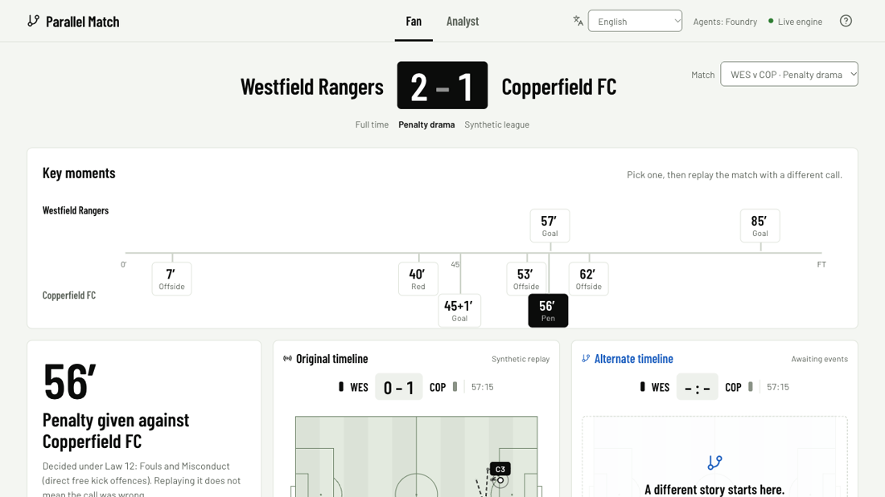
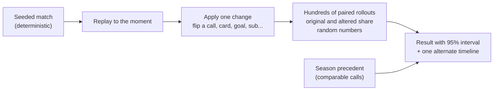
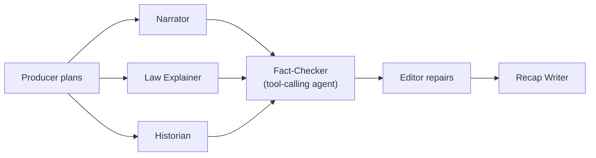

# Parallel Match

Microsoft x Premier League "Inside the Game" developer hackathon entry.

A fan taps a contestable moment (foul, offside, card, penalty, substitution) and asks *"what if that wasn't a foul?"* The screen splits into the real match and an alternate one, backed by Monte Carlo re-simulation and precedent from the league's own history.

**[Demo video (under 2 min)](https://youtu.be/Qt4DRwWWmOo)** · **[Live demo](https://pm-web.agreeableflower-13af161d.japaneast.azurecontainerapps.io/)** (no login). Pick English, then match **WES v COP** and ask *"what if that was not a penalty?"* at 56'.



> **All data is synthetic.** Fictional clubs and players only. No real match data, logos, names or music. The alternate timeline is a simulation, not a prediction of real football, and every number comes with its uncertainty.

## How "what if" works



Because both branches share random numbers, the difference is the change, not luck. A second, independent opinion comes from precedent in the season itself, and the response says so when the two disagree.

## Multi-agent Match Desk



All numbers and moment-finding stay in plain code. Agents only phrase them, and guardrails reject output containing numbers not in the facts or wording that judges officials. A test swaps a number and checks that only the Fact-Checker catches it.

## Microsoft stack

| Service | Used for | Status |
|---|---|---|
| Microsoft Agent Framework + Azure AI Foundry | Narrator, Law Explainer, Historian, Fact-Checker; managed identity, guardrails, template fallback | Live (`gpt-4.1-mini`) |
| MCP | Season precedent as tools (`history_query`, `season_summary`) | Live |
| Azure Container Apps | Four apps: front end, simulator API, agents API, MCP server | Live, Japan East |
| Microsoft Fabric | Season tables and precedent query in SQL | Ready, not loaded for this submission |

The interface ships in **18 languages** (Arabic laid out right to left), and a test fails if any language misses a key.

<details>
<summary>Judge Q&A: realism, speed, neutrality</summary>

| Question | Answer |
|---|---|
| Is it football-like? | Over 360 matches: 2.78 goals, 27.4 shots, 82% pass accuracy, 24.4 fouls, 3.2 yellows per match. All 16 metrics fall inside approximate top-flight ranges ([report](reports/realism_v1.md)). A sanity band, not measured truth. |
| How fast? | A full match simulates in about 60 ms. 200 rollouts take 2 to 4 s on 8 workers. Featured moments are precomputed at 500 rollouts and return in about 1 s live. A fresh fork on the single-CPU deployed API takes about 25 s, so try featured moments first. |
| Neutral about officials? | Decisions are explained against the Law of the Game with the measured margin. Nothing says a referee or player "got it wrong". |
| Known limits | Event-level model, not physics. Positions derive from formations. Precedent compares different matches, so it carries confounding; the paired simulation is the cleaner estimate. |
</details>

## Run it

Python 3.11+, no dependencies for the simulator.

```bash
python3 -m parallel_match match --home HAR --away NOR --seed 12   # one match
python3 -m parallel_match fork --match m052 --event m052-0715     # what if that penalty was not given?
python3 -m parallel_match realism --matches 360                   # writes reports/realism_v1.md
python3 -m unittest discover -s tests -t .                        # all tests
```

```bash
python3 -m venv .venv && .venv/bin/pip install -r requirements-api.txt
.venv/bin/uvicorn parallel_match.api:app --reload                 # API docs at localhost:8000/docs
cd frontend && npm install && npm run dev                         # React + Vite match viewer
```

## Repo map

| Path | Contents |
|---|---|
| `parallel_match/` | Simulator (`sim.py`), Laws (`rules.py`), what-if engine (`fork.py`), precedent (`history.py`), FastAPI (`api.py`) |
| `agents/`, `mcp_history/` | Phrasing agents and Match Desk, MCP precedent server |
| `frontend/` | React match viewer with SVG pitch |
| `docs/` | API, agents, deployment runbook, [SUBMISSION.md](docs/SUBMISSION.md) |
| `tests/`, `reports/`, `deploy/` | Determinism, fork, API, agents tests; realism report; Azure deploy scripts |
